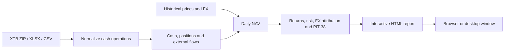

# XTB Portfolio Analyzer

[](https://github.com/Oliwciu123/XTB_Portfolio_Tracker/actions/workflows/ci.yml)
[](https://www.python.org/)
[](LICENSE)

**Portable downloads (no Python needed):**
[Download for Windows (`XTBPortfolioAnalyzer-Windows.zip`)](https://github.com/Oliwciu123/XTB_Portfolio_Tracker/releases/latest/download/XTBPortfolioAnalyzer-Windows.zip) ·
[Download for macOS (`XTBPortfolioAnalyzer-macOS.zip`)](https://github.com/Oliwciu123/XTB_Portfolio_Tracker/releases/latest/download/XTBPortfolioAnalyzer-macOS.zip) ·
[Latest GitHub Release](https://github.com/Oliwciu123/XTB_Portfolio_Tracker/releases/latest)


**Turn an XTB account export into an interactive portfolio report.** A Python CLI
and desktop app for investors who want to understand performance across PLN, USD
and EUR accounts. It reconstructs cash and positions, separates investment and
currency effects, and compares results with deposit-matched benchmarks. Try the
offline demo below: every account, transaction, quote and FX rate is fictional.

The seeded demo spans **January 2021–November 2026**, with **15 instruments and
284 cash operations**. It deliberately includes losses and drawdowns. The familiar
tickers and index names label simulated paths, not actual historical returns.

## Features

- ROI, money-weighted return (XIRR) and daily time-weighted return (TWR).
- NAV reconstruction from cash operations, fractional positions and stock splits.
- Volatility, drawdown, Sharpe, Sortino, Calmar, historical VaR, win rate, profit factor and benchmark relations, with interactive plain-English KPI definitions, examples and reference benchmarks.
- Deposit analytics with monthly capital histograms, single- and multi-year filters, month-level operation drill-downs and a dynamic Top 10 deposit months ranking.
- Polish PIT-38 tax settlement: strict FIFO lot matching, official `D-1` NBP Table A currency conversions (with weekend/holiday lookback), brokerage commissions and foreign dividend withholding-tax (`podatek u źródła`) credits.
- PLN FX attribution, income, taxes, company P&L and holdings allocation.
- Interactive, self-contained HTML reports with PNG and comparison/tax CSV export.
- Desktop ZIP import, progress feedback and live refresh; custom Yahoo symbols.

## No Python needed

### Windows
1. Download [`XTBPortfolioAnalyzer-Windows.zip`](https://github.com/Oliwciu123/XTB_Portfolio_Tracker/releases/latest/download/XTBPortfolioAnalyzer-Windows.zip) from the latest GitHub Release.
2. Extract everything, including `_internal`, into one folder.
3. Open the extracted `XTBPortfolioAnalyzer` folder and run `XTBPortfolioAnalyzer.exe`.

For the offline demo on Windows, open a terminal in that folder and run:

```powershell
.\XTBPortfolioAnalyzer.exe --demo
```

### macOS
1. Download [`XTBPortfolioAnalyzer-macOS.zip`](https://github.com/Oliwciu123/XTB_Portfolio_Tracker/releases/latest/download/XTBPortfolioAnalyzer-macOS.zip) from the latest GitHub Release.
2. Extract the archive and open `XTBPortfolioAnalyzer/XTBPortfolioAnalyzer.app` (right-click and choose **Open** on first launch).

For the offline demo on macOS:

```sh
./XTBPortfolioAnalyzer/XTBPortfolioAnalyzer.app/Contents/MacOS/XTBPortfolioAnalyzer --demo
```

Requires Windows 10/11 (64-bit) with Microsoft Edge WebView2, or macOS 13+ (Apple Silicon).
Both portable builds are unsigned. An internet connection is needed for market data;
the bundled demo runs offline.

## Quickstart

Install [uv](https://docs.astral.sh/uv/getting-started/installation/), then run from
the repository root on Windows, macOS or Linux:

```sh
git clone https://github.com/Oliwciu123/XTB_Portfolio_Tracker.git
cd XTB_Portfolio_Tracker
uv sync
uv run xtb-analyzer --demo
```

Open `output/report.html` in a browser after generation, or add `--open` to the command.
The demo needs no XTB account,
API key or market-data connection after dependencies are installed.

Desktop demo (native webview, optional dependencies):

```sh
uv run --extra desktop xtb-analyzer-desktop --demo
```

For your own export, run `uv run --extra desktop xtb-analyzer-desktop` and choose
an XTB ZIP. Or extract full account workbooks into the ignored `data/` folder:

```sh
uv run xtb-analyzer --data-dir data --currency pln --open
```

Real-data analysis fetches Yahoo Finance prices and NBP FX over the internet.
`--no-live` disables current quotes; it does not disable historical downloads.
See the [user guide](docs/USER_GUIDE.md) for desktop and portable usage.

## Screenshots

Actual application renders using the seeded demo. Browser images are captured at
1600×1000 with 2× pixel density; desktop images capture the real pywebview HWND.
The captures use the current application panels and controls without adding,
hiding, or restyling features for the screenshots.

**Reconstructed NAV and net contributions.**


**Deposit-matched comparison with four fictional index paths.**


**Position, currency and sector allocation, excluding cash.**


**Realized and unrealized position results.**


**Monthly TWR returns.** These are percentages, not monetary monthly P&L.


**Investment and FX gains, with the per-currency breakdown.**


<details>
<summary>Native desktop windows and report sections</summary>

The actual Windows import screen and the loaded offline report, without browser chrome:


The HTML report is captured in three sections, rather than one long page:


Company price P&L (income is reported separately):


</details>

## How it works



## Input format

Use complete xStation account histories with a **CASH OPERATION HISTORY** sheet,
including funding before the first purchase. Account currency is inferred from
`PLN`, `USD`, `EUR` or `EURO` in workbook names. Supported legacy and v2 CSV
cash-operation layouts are covered by parser fixtures. Closed-position summaries
alone cannot reconstruct a portfolio. Localized column aliases remain supported.

[`examples/`](examples/README.md) includes reproducible XLSX/ZIP histories and
fictional market series. Private exports, reports and caches are gitignored.

## Methodology

- **NAV:** cash plus shares × unadjusted price, translated into the report currency.
- **ROI:** `(NAV + withdrawals − gross deposits) / gross deposits`.
- **XIRR:** solves `Σ CFᵢ / (1 + r)^(daysᵢ / 365.25) = 0`, including terminal NAV.
- **TWR:** chains `NAVₜ / (NAVₜ₋₁ + external flowₜ) − 1`; flows are assumed to
  occur at the start of each day.
- **Risk:** daily TWR observations; volatility uses `√252`, default risk-free rate 0%.
- **Benchmarks:** hypothetical purchases and sales with the same external flows,
  converted to the report currency. The comparison chart shows ROI.
- **PIT-38:** strict per-account FIFO lot matching and dividend WHT credit (capped at 19%
  per payment), translated into PLN at the official `D-1` NBP Table A mid rate.

Assumptions, FX decomposition and edge cases are in
[METHODOLOGY.md](docs/METHODOLOGY.md). The mathematical audit and the legacy ROI
fix are recorded in [AUDIT.md](docs/AUDIT.md).

## Project structure

```text
src/xtb_analyzer/   Parser, financial/PIT-38 engine, report and desktop app
tests/             Reference metrics, parser, PIT-38 and UI regression tests
examples/          Entirely fictional account and market data
scripts/           Sample generation and real screenshot capture
packaging/         PyInstaller specification and Windows/macOS release builder
docs/              Methodology, user guide, release notes and screenshots
notebooks/         Optional offline exploration of the same engine
```

## Development

```sh
uv run ruff check .
uv run ruff format --check .
uv run pytest
uv run playwright install chromium
uv run python scripts/make_screenshots.py
```

On Windows, capture the actual desktop windows as well:

```sh
uv run --extra desktop python scripts/make_screenshots.py --native
```

Regenerate the demo through today, or pin its end date for byte reproducibility:

```sh
uv run python scripts/generate_demo_data.py --seed 42 --end-date 2026-11-07
```

Small parser fixtures are maintained separately by `scripts/generate_test_fixtures.py`.

CI defines lint, formatting, tests and demo execution on Ubuntu, Windows and
macOS with Python 3.10 and 3.13. A separate job renders screenshots. Tagged `v*`
pushes trigger `.github/workflows/release.yml` to build and publish portable
Windows and macOS release archives. Dependencies are locked in `uv.lock`; use
`uv sync --locked` to reproduce them. See the [verification record](docs/VERIFICATION.md)
for checks actually run locally. The consolidated commit history and its actual
feature dates are described in [HISTORY.md](docs/HISTORY.md).

## Limitations

- Account valuation supports PLN, USD and EUR; broker layout changes may need new aliases.
- Daily TWR approximates intraday flows. XIRR can have no solution or multiple roots.
- Market data may be delayed, unavailable or revised. Polling does not guarantee new quotes.
- Benchmarks need sufficient Yahoo history and supported quote currency/FX. They exclude
  commissions and taxes; futures are price comparisons without a margin or roll model.
- PIT-38 calculations are educational estimates from exported cash operations; verify against
  official PIT-8C forms and tax counsel before filing.
- The demo is illustrative, not an investment strategy or a record of actual performance.
- Portable PyInstaller release archives are built for Windows and macOS; binaries are unsigned
  and native desktop rendering depends on the platform's webview runtime.

## Roadmap

- Add fixtures for more broker export versions and corporate actions.
- Add explicit intraday cash-flow timing where source data permits it.
- Code-sign and notarize Windows and macOS desktop release artifacts.

## License

[MIT](LICENSE). Project presentation material: [CV and interview notes](docs/CV_PROJECT_DESCRIPTION.md).
