# XTB Portfolio Tracker

[](https://github.com/Oliwciu123/XTB_Portfolio_Tracker/actions/workflows/ci.yml)
[](https://www.python.org/)
[](LICENSE)

**Portable downloads (no Python needed):**
[Download for Windows (`XTBPortfolioAnalyzer-Windows.zip`)](https://github.com/Oliwciu123/XTB_Portfolio_Tracker/releases/latest/download/XTBPortfolioAnalyzer-Windows.zip) ·
[Download for macOS (`XTBPortfolioAnalyzer-macOS.zip`)](https://github.com/Oliwciu123/XTB_Portfolio_Tracker/releases/latest/download/XTBPortfolioAnalyzer-macOS.zip) ·
[Latest GitHub Release](https://github.com/Oliwciu123/XTB_Portfolio_Tracker/releases/latest)

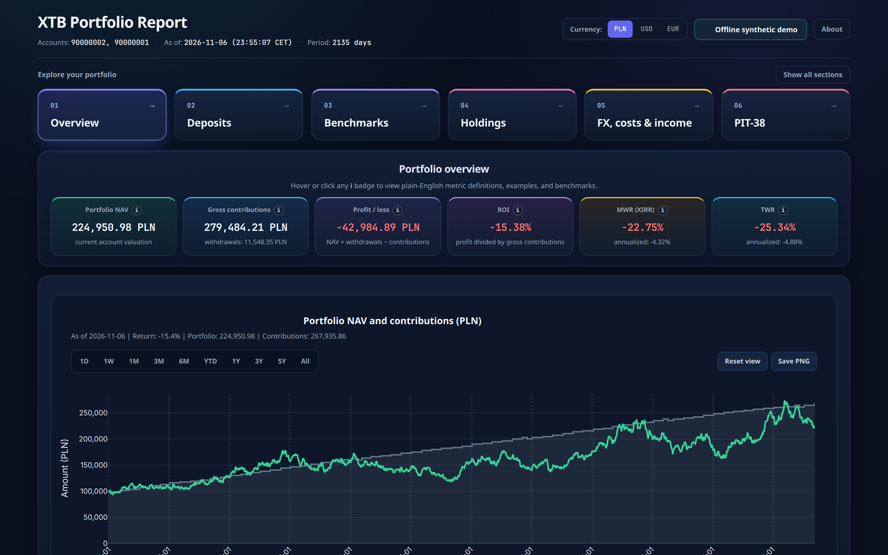

XTB Portfolio Tracker turns an XTB account export into one self-contained HTML
report. It rebuilds cash, holdings, and daily NAV across PLN, USD, and EUR
accounts, then shows performance, risk, currency effects, and a Polish PIT-38
estimate. There is no server and no database. The same engine drives the CLI
and the desktop window.

The seeded demo covers **January 2021–November 2026**, with **15 instruments and
284 cash operations**. Every account, trade, quote, and FX rate is fictional,
and the series includes losses. Familiar tickers label simulated paths.

## Try it

Install [uv](https://docs.astral.sh/uv/getting-started/installation/), then:

```sh
git clone https://github.com/Oliwciu123/XTB_Portfolio_Tracker.git
cd XTB_Portfolio_Tracker
uv sync --locked
uv run xtb-analyzer --demo
```

Open `output/report.html`. The demo needs no account, API key, or network after
dependencies are installed. `uv run --extra desktop xtb-analyzer-desktop --demo`
opens the same report in the desktop window.

Windows and macOS zips on the [latest release](https://github.com/Oliwciu123/XTB_Portfolio_Tracker/releases/latest)
are unsigned PyInstaller builds. Extract the whole archive, keep `_internal`
beside the app, and run `XTBPortfolioAnalyzer.exe` or
`XTBPortfolioAnalyzer.app`. Add `--demo` for the offline example. A local
`build_windows.bat` also places an **XTB Portfolio Tracker** shortcut on the
Windows desktop. Details are in the [user guide](docs/USER_GUIDE.md).

For a real export, keep the history private and run
`uv run xtb-analyzer --data-dir data --currency pln`. Yahoo Finance and NBP
are required for live prices and FX. `--no-live` skips current quotes only.

## What is on the report

**One hover readout.** Every chart uses a single card (date, series, marker,
value). The native Plotly tooltip is suppressed.

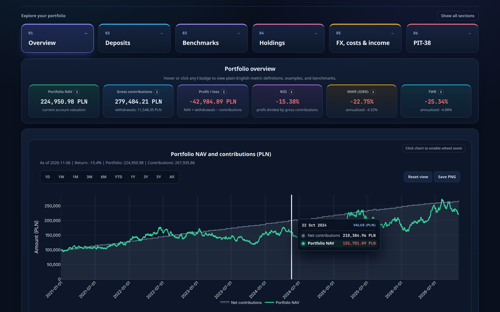

**Deposits.** External funding is separated from transfers between your own
accounts, with year filters and a monthly histogram.

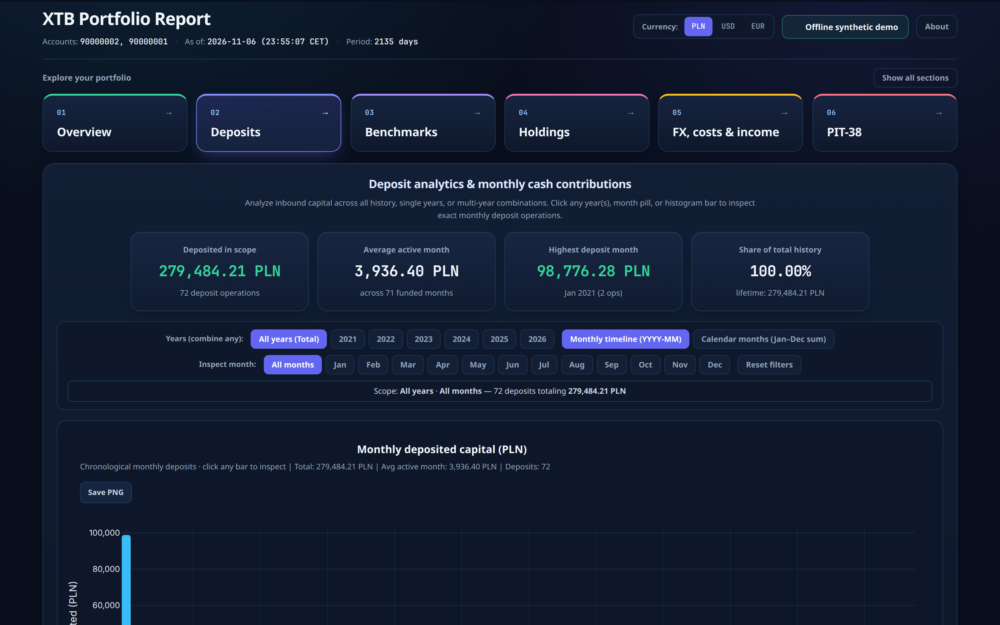

**PIT-38 estimate.** Closed lots are matched FIFO. Sale proceeds and costs use
the previous business day's NBP Table A rate. Foreign dividend withholding tax
is credited up to 19% per payment.

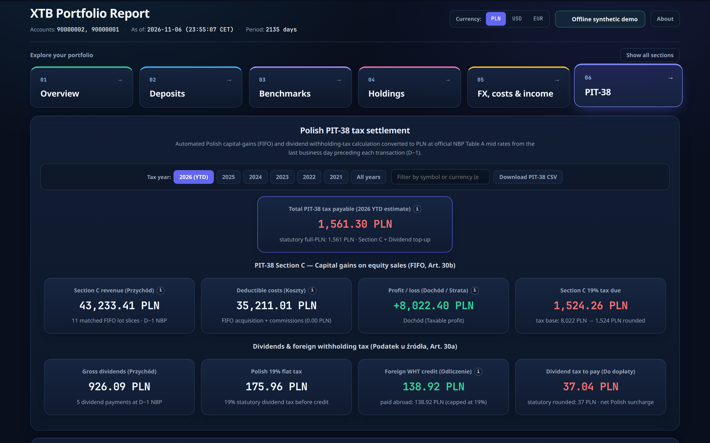

**Indicator guide.** An indicator button shows the name, a one-line meaning,
and this portfolio's value. Learn more stays inside the report: formula,
worked steps that end on the dashboard figure, a generic example, and the
reference band that contains the value.

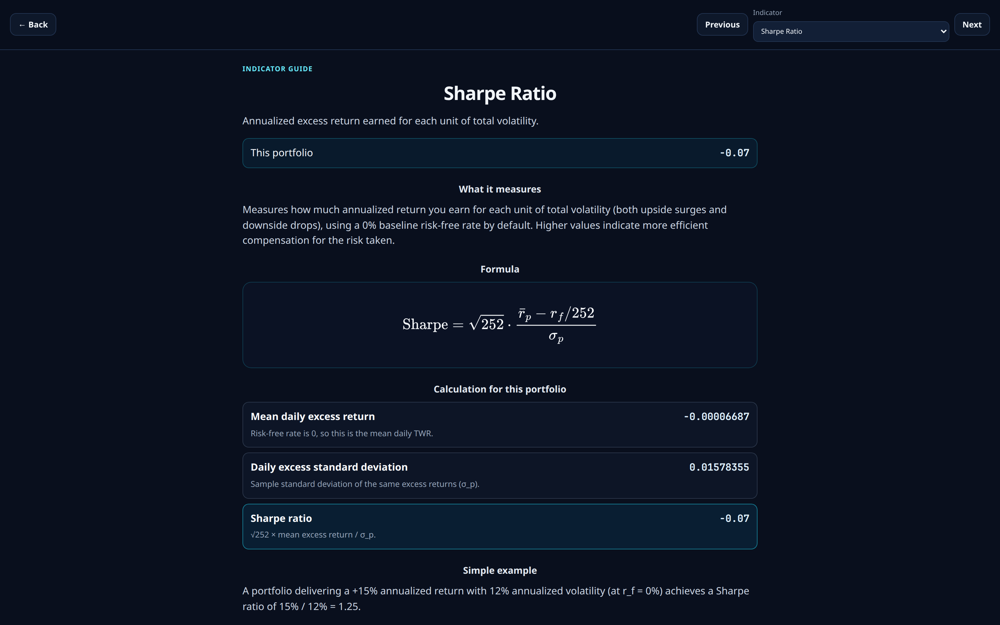

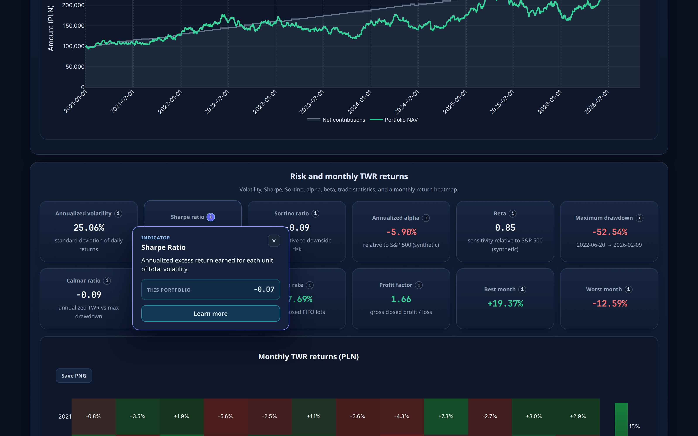

Other views from the same demo:

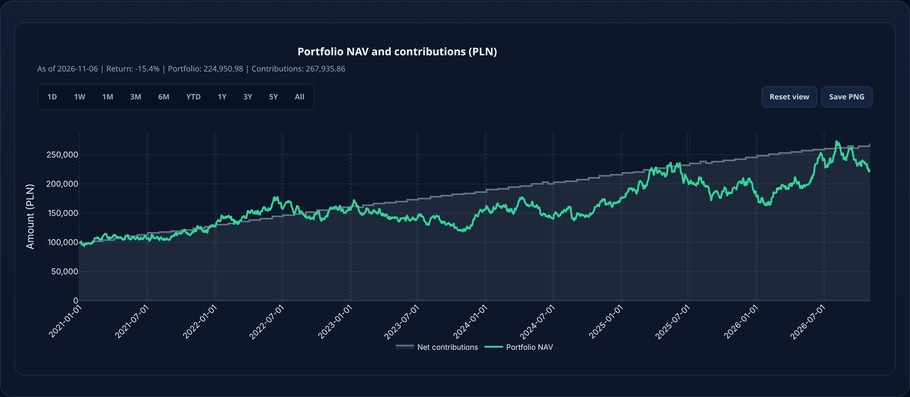

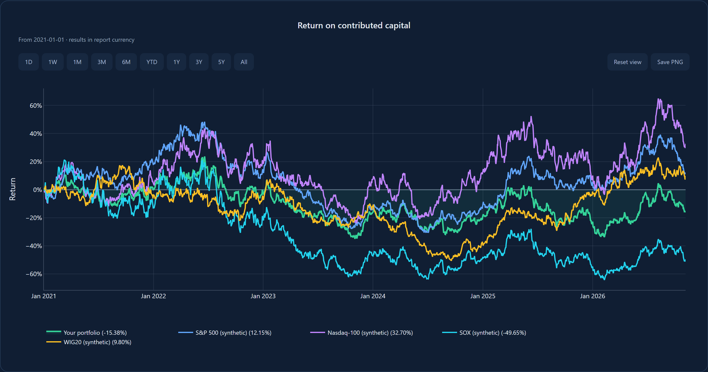

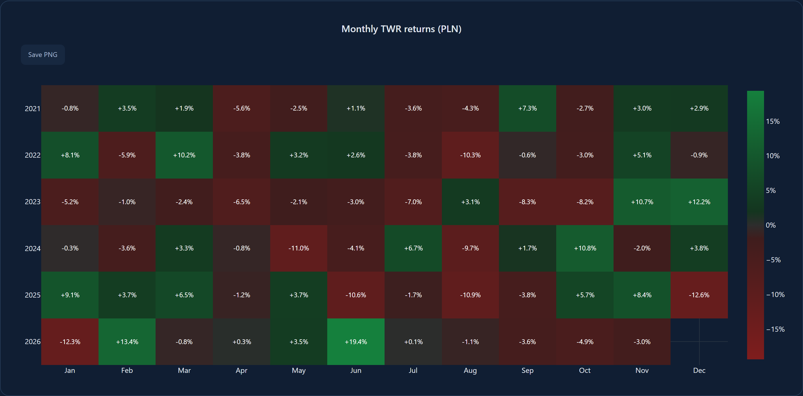

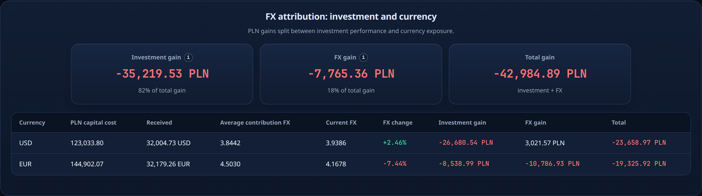

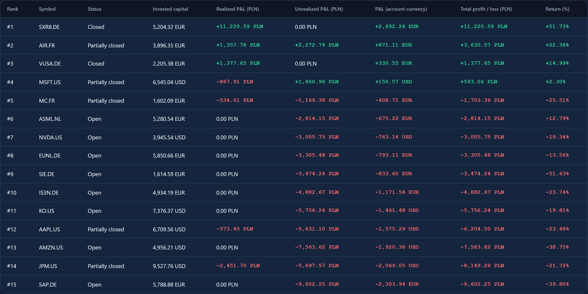

## What is technically interesting

The accounting is explicit. NAV is cash plus shares times the unadjusted price,
in the report currency. ROI is `(NAV + withdrawals − gross contributions) / gross
contributions`. XIRR solves `Σ CFᵢ / (1 + r)^(daysᵢ / 365.25) = 0`. Daily TWR is
`NAVₜ / (NAVₜ₋₁ + external flowₜ) − 1`, and risk statistics (volatility, Sharpe,
Sortino, drawdown, Calmar, historical VaR) use that chain with a 0% risk-free
rate. Benchmarks replay the same external flows. FX attribution splits price
results from currency moves. PIT-38 uses `Decimal` and per-account FIFO, not a
rounded shortcut.

The report is one HTML file. Plotly.js and the MathJax SVG renderer, including
its font paths, are embedded. Nothing is loaded from a CDN, so the file still
works offline and inside the desktop webview.

Checks are `ruff`, `pytest`, and `xtb-analyzer --demo`. GitHub Actions runs
those on Ubuntu, Windows, and macOS for Python 3.10 and 3.13, plus a screenshot
job that renders the demo UI. A `v*` tag runs
[`.github/workflows/release.yml`](.github/workflows/release.yml), which publishes
the Windows and macOS zips. Dependencies are pinned in `uv.lock`.

Definitions and regression cases are documented in
[METHODOLOGY.md](docs/METHODOLOGY.md) and [AUDIT.md](docs/AUDIT.md). The demo
generator is `scripts/generate_demo_data.py --seed 42 --end-date 2026-11-07`.

```text
src/xtb_analyzer/   Parser, portfolio engine, PIT-38, HTML report, desktop window
tests/              Parser fixtures and financial regression tests
examples/           Fictional accounts and market data
packaging/          PyInstaller spec and the Windows/macOS release builder
```

## Limits

Daily TWR treats each external flow as happening at the start of the day. XIRR
can fail to find a root. Market data can be missing or revised. The PIT-38
section is an estimate from the export, not a filing. Benchmarks omit
commissions and taxes. The desktop binaries are unsigned. Valuation currencies
are PLN, USD, and EUR.
